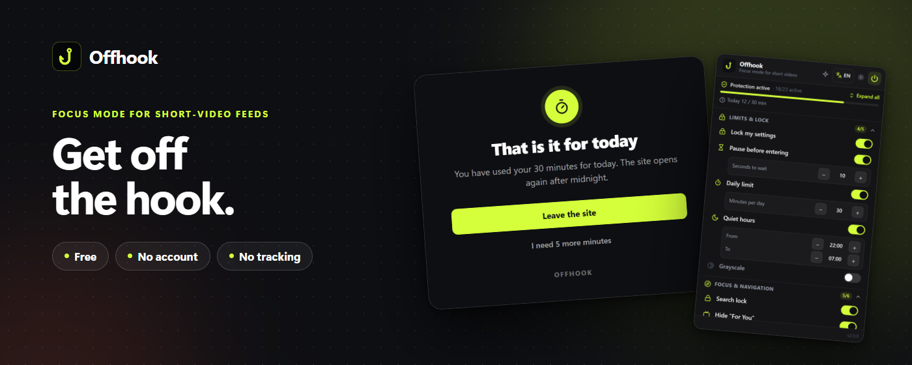

# Offhook

**Distraction-free focus mode for TikTok** (desktop, tiktok.com). Offhook hides the For You feed, comments and counters, and adds limits that are deliberately hard to talk your way out of. It is the extension for people trying to unhook from TikTok.

Free and open source. No account, no analytics, no server. English and Polish.

[Privacy policy](PRIVACY_POLICY.md)

## What it does

### Limits and lock

| Feature | What happens |
| --- | --- |
| **Lock my settings** | Switching a protection off, or loosening a limit, first requires typing a sentence by hand: one letter per second, a typo rewinds eight letters, then a three-second hold. Settings then stay open for 3 minutes. Each attempt the same day adds another sentence (up to three). |
| **Turning Offhook off** | Always goes through the same typing ritual, even when "Lock my settings" is off. |
| **Pause before entering** | A countdown before the site opens, once per tab. |
| **Daily limit** | After the set number of minutes the site is covered until midnight. Time is counted across all tabs. |
| **Quiet hours** | The site is covered between two hours every day (the window may cross midnight). |
| **"5 more minutes" pass** | Lifts a limit or quiet hours for 5 minutes after typing a random code. The code grows with every pass that day: 30, 45, 60, 75, 90 characters. |
| **Search lock** | Search opens for 5 minutes after typing a 30-character code. |
| **Grayscale** | Shows the whole site in black and white. |

A fresh install leaves settings open for 10 minutes so you can set things up.

### Feed clean-up

* Hide the "For You" and "Explore" entries, the "Friends" feed, LIVE, the shop and sponsored blocks
* Open your profile instead of the home feed
* Hide comments, like/comment/share counters, or the action buttons altogether
* Hide suggested accounts, collapse the list of followed accounts, hide follower counts
* Hide coin and "get the app" prompts, the sidebar footer and red notification dots
* Hide descriptions until you hover over a video
* "Viral only": skip videos below your own like and comment thresholds
* Keep playing in background when you switch tabs
* Dark and light popup

### What it cannot do

Offhook is a browser extension, so the browser itself can still remove or disable it from the extensions page. The lock makes switching off slow and deliberate; it is not parental control.

## Compatibility

Runs only on `tiktok.com` (desktop web). It does nothing on any other site.

TikTok is a trademark of its owner. Offhook is an independent project and is not affiliated with, endorsed by, or sponsored by TikTok.

## Install

* **Firefox:** [Mozilla Add-ons](https://addons.mozilla.org/en-US/firefox/addon/tiktok-unhook-distraction-free/)
* **Chrome / Edge, from source:** `npm install`, `npm run build`, then load `.output/chrome-mv3` on `chrome://extensions` with Developer mode on.

## Development

Built with [WXT](https://wxt.dev), TypeScript and Tailwind CSS. Requires Node 22.18 or newer.

| Command | Purpose |
| --- | --- |
| `npm run dev` / `npm run dev:firefox` | Dev mode with hot reload |
| `npm run build` / `npm run build:firefox` | Unpacked build in `.output/` |
| `npm run zip` / `npm run zip:firefox` | Store-ready ZIP in `.output/` |
| `npm run compile` | Type check |
| `npm test` | Unit tests for the lock, limits and settings logic |
| `npm run e2e` | Runs the built bundles in headless Edge against a local mock site (run `npm run build` first) |
| `npm run icons` | Regenerates PNG icons from `public/icon.svg` |
| `npm run promo` | Regenerates store screenshots and tiles in `promo/en` and `promo/pl` |
| `npm run promo:video` | Regenerates the 1920x1080 promo video |

On Windows the `URUCHOM_*.bat` files wrap the dev and zip commands.

`npm run e2e`, `npm run promo` and `npm run promo:video` need Microsoft Edge installed. They load the content script and popup into a local mock page with a stubbed extension API, so they check Offhook's own behavior, not the live site.

The name, store texts and colors live in `utils/brand.ts`; the localized store name and summary are in `public/_locales`. Store listing texts are in [`promo/STORE_LISTING.md`](promo/STORE_LISTING.md).
